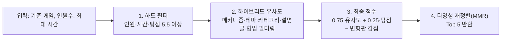
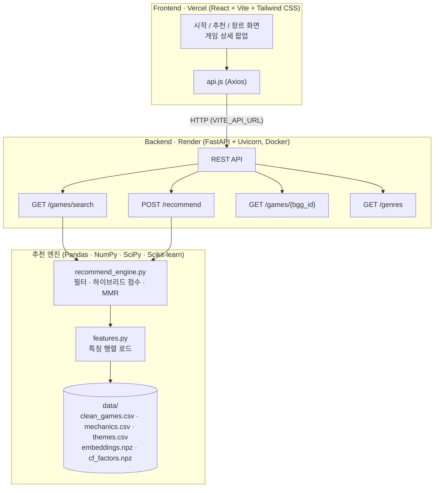

# 🎲 BoardGame Recommender (보드게임 추천 시스템)

<div align="center">


<br/>

**좋아하는 보드게임 하나와 인원·시간만 알려 주면, 플레이 감각이 비슷한 보드게임을 찾아 주는 추천 웹 서비스**

[📖 프로젝트 계획서](docs/project_plan.md) • [⚙️ 개발 환경 세팅](docs/setup.md) • [🔌 백엔드 API](docs/backend_api.md) • [🧠 추천 파이프라인](docs/recommendation_pipeline.md) • [🚀 배포 가이드](docs/deploy.md)

</div>

---

## 📌 목차
1. [프로젝트 개요](#-프로젝트-개요)
2. [주요 기능](#-주요-기능)
3. [추천 로직](#-추천-로직)
4. [시스템 아키텍처](#-시스템-아키텍처)
5. [기술 스택](#-기술-스택)
6. [데이터셋](#-데이터셋)
7. [프로젝트 구조](#-프로젝트-구조)
8. [개발 진행 내역](#-개발-진행-내역)
9. [시작 가이드 (Quick Start)](#-시작-가이드-quick-start)

---

## 🎯 프로젝트 개요

* **프로젝트명**: 보드게임 추천 시스템 (BoardGame Recommender)
* **목표**: BoardGameGeek(BGG) 보드게임 데이터를 정제하고, 메커니즘·테마·설명글·사용자 평점을 결합한 하이브리드 추천 엔진을 FastAPI 백엔드와 React 프론트엔드로 서비스
* **수행 기간**: 총 7주 (주당 6\~8시간 학습 및 실습)
* **참여 인원**: 4명
* **배포**: 백엔드 Render (Docker), 프론트엔드 Vercel

---

## 💡 주요 기능

| 화면 | 기능 |
| :--- | :--- |
| **시작 화면** | 이용 방법 3단계 안내, "비슷한 게임 추천받기" / "장르별로 둘러보기" 선택 |
| **추천 화면** | 게임 이름 자동완성 검색 → 인원(2\~6명)·플레이 시간(30분\~2시간 이하) 선택 → 비슷한 게임 Top 5와 공통 메커니즘·테마(추천 이유) 표시 |
| **장르 화면** | 전략·가족·파티·테마·워게임·어린이·카드게임·추리 8개 장르별 대표 게임 (리뷰 1,000개 이상 중 평점 상위 6개) |
| **게임 상세 팝업** | 어느 화면에서든 게임을 누르면 인원·시간·난이도·평점·설명을 보여 주고, 그 게임 기준으로 바로 추천받기 |

백엔드에는 화면에서 아직 쓰지 않는 **자연어(한국어 가능) 게임 검색 API** (`GET /games/semantic-search`)도 있습니다. 선택 패키지를 설치해야 동작합니다. 전체 API 목록은 [docs/backend_api.md](docs/backend_api.md)를 참고하세요.

---

## 🧠 추천 로직

단순히 평점순으로 나열하지 않고, **사용자 조건으로 후보를 거른 뒤 여러 유사도 신호를 합쳐 순위를 매깁니다.**



1. **하드 필터**: `MinPlayers ≤ 인원 ≤ MaxPlayers`, `ComMaxPlaytime ≤ 최대 시간`, `BayesAvgRating ≥ 5.5`인 게임만 후보로 남김
2. **하이브리드 유사도**: 기준 게임과 후보 게임을 다음 신호로 비교해 가중 평균

   | 신호 | 데이터 | 가중치 |
   | :--- | :--- | :---: |
   | 메커니즘 | `mechanics.csv` (드문 메커니즘일수록 큰 의미, IDF 가중) | 0.40 |
   | 협업 필터링 | `cf_factors.npz` ("이 게임을 좋아한 사람들이 함께 좋아한 게임") | 0.40 |
   | 설명글 | `embeddings.npz` 문장 임베딩 (없으면 TF-IDF) | 0.20 |
   | 테마 | `themes.csv` (IDF 가중) | 0.15 |
   | 카테고리·난이도 | `games.csv`의 `Cat:*`, `GameWeight` | 0.10 |
3. **최종 점수**: 유사도 75% + 평점 25%. 같은 시리즈 변형판(예: Catan → Simply Catan)은 감점
4. **다양성 재정렬**: 이미 고른 게임과 메커니즘이 거의 같은 게임은 감점하며 5개를 고름

**오프라인 평가** (평가 사용자 1,000명, K=10): 초기 TF-IDF 방식 대비 HitRate@10이 **0.134 → 0.450 (약 3.4배)** 로 향상되었습니다.
신호별 계산 방법, 가중치 튜닝, 평가 방법은 [docs/recommendation_pipeline.md](docs/recommendation_pipeline.md)에 정리되어 있습니다.

---

## 🏗️ 시스템 아키텍처



---

## 🛠️ 기술 스택

| 분류 | 기술 / 도구 | 용도 |
| :--- | :--- | :--- |
| **Environment** | `uv`, `Python 3.12`, `Node.js` | 가상환경·패키지 관리, 프론트엔드 빌드 |
| **Data & ML** | `Pandas`, `NumPy`, `SciPy`, `Scikit-learn` | 데이터 정제, 희소 행렬 코사인 유사도, TF-IDF, Truncated SVD(협업 필터링) |
| **Embedding (선택)** | `sentence-transformers` (`intfloat/multilingual-e5-small`) | 설명글 임베딩 생성, 자연어 검색 |
| **Backend** | `FastAPI`, `Uvicorn` | REST API 서버, Swagger UI 문서화 |
| **Frontend** | `React 19`, `Vite 8`, `Tailwind CSS 4`, `Axios`, `lucide-react` | 화면 구성, API 호출, 아이콘 |
| **Quality** | `unittest` + `httpx`(TestClient), `ruff`, `oxlint` | API 테스트, Python·JS 린트 |
| **Deploy** | `Docker`, `Render`, `Vercel` | 백엔드·프론트엔드 무료 배포 |
| **Collaboration** | `Git`, `GitHub`, `Jupyter Lab`, `VS Code` | 버전 관리, 데이터 탐색(EDA) |

---

## 📊 데이터셋

[Kaggle의 BoardGameGeek 데이터셋](https://www.kaggle.com/datasets/threnjen/board-games-database-from-boardgamegeek)을 사용합니다. 원본 `games.csv` 21,925개 게임 중 정제 후 **21,125개**가 추천 대상입니다.

| 파일 | 내용 | git 포함 |
| :--- | :--- | :---: |
| `data/games.csv` | BGG 원본 게임 메타데이터 (카테고리 `Cat:*` 컬럼 포함) | ✅ |
| `data/clean_games.csv` | 정제된 13개 핵심 컬럼 (추천 엔진의 기본 데이터) | ✅ |
| `data/mechanics.csv`, `data/themes.csv` | 게임별 메커니즘·테마 (0/1 행렬) | ✅ |
| `data/embeddings.npz` | 설명글 문장 임베딩 (`backend/build_embeddings.py`로 생성) | ✅ |
| `data/cf_factors.npz` | 협업 필터링 게임 벡터 (`backend/build_cf.py`로 생성) | ✅ |
| `data/user_ratings.csv` | 사용자별 평점 (수백 MB). 협업 필터링 재학습·성능 평가에만 필요 | ❌ 각자 다운로드 |

`clean_games.csv`의 주요 컬럼:

| 컬럼명 | 설명 | 사용처 |
| :--- | :--- | :--- |
| `BGGId` | BoardGameGeek 고유 식별자 | 게임 식별, 상세 조회 (`/games/{bgg_id}`) |
| `Name` | 보드게임 이름 (영어) | 검색, 기준 게임 지정 |
| `YearPublished` | 출시 연도 | 화면 표시 |
| `GameWeight` | 체감 난이도 (1\~5) | 화면 표시, 카테고리 유사도 |
| `MinPlayers` / `MaxPlayers` | 최소/최대 인원 | 인원 필터 |
| `BestPlayers` | 최적 인원 (투표 없으면 공식 인원 중간값으로 보정) | 상세 팝업 표시 |
| `ComMinPlaytime` / `ComMaxPlaytime` | 최소/최대 플레이 시간 (분) | 시간 필터 |
| `BayesAvgRating` | 베이지안 평균 평점 | 최소 평점 필터, 최종 점수의 평점 항목 |
| `NumUserRatings` | 평가 참여 유저 수 | 장르 대표 게임 선정 (1,000개 이상) |
| `Description` | 게임 설명글 (영어, 전처리됨) | TF-IDF, 상세 팝업 |
| `ImagePath` | 표지 이미지 URL | 카드·썸네일 표시 |

---

## 📁 프로젝트 구조

```text
boardgame-recommender/
├── backend/                     # FastAPI 서버 & 추천 엔진
│   ├── main.py                  # REST API 엔드포인트, CORS 설정
│   ├── recommend_engine.py      # 조건 필터, 하이브리드 점수, 변형판 감점, MMR, 자연어 검색
│   ├── features.py              # 데이터·특징 행렬 로드 (메커니즘, 테마, 카테고리, TF-IDF, 임베딩, CF)
│   ├── genres.py                # 장르별 대표 게임 계산 (GET /genres)
│   ├── semantic.py              # 임베딩 모델 로드·인코딩 (선택 기능)
│   ├── build_embeddings.py      # data/embeddings.npz 생성
│   ├── build_cf.py              # data/cf_factors.npz 생성
│   └── evaluate.py              # 오프라인 성능 평가
├── frontend/                    # React 프론트엔드 (Vite)
│   ├── .env.example             # VITE_API_URL 예시
│   └── src/
│       ├── App.jsx              # 화면 전환 (시작 / 추천 / 장르) + 상세 팝업
│       ├── screens/             # StartScreen, RecommendScreen, GenreScreen
│       ├── components/          # GameSearch, SelectedGameCard, GameDetailModal, GameThumb, OptionGroup
│       ├── api.js               # 백엔드 요청 함수
│       ├── format.js            # 플레이 시간 표시, 조사(와/과) 처리 등 글자 변환
│       └── styles.js            # 공통 버튼 스타일
├── data/                        # 데이터셋과 추천 모델 산출물 (위 표 참고)
├── notebooks/                   # 1~3주차 데이터 탐색·실습
│   ├── read_game_csv.ipynb      # EDA, 정제
│   ├── clean_data.py            # 결측치·이상치 정제 → clean_games.csv
│   └── cosine_similarity.ipynb  # TF-IDF 코사인 유사도 실습
├── tests/test_api.py            # API 자동 테스트
├── docs/                        # 프로젝트 문서
│   ├── project_plan.md          # 주차별 계획·진행 내역
│   ├── setup.md                 # 개발 환경 세팅
│   ├── backend_api.md           # API 명세, 오류 처리, 테스트
│   ├── recommendation_pipeline.md # 추천 알고리즘, 선택 기능, 성능 평가
│   └── deploy.md                # Render·Vercel 배포
├── Dockerfile                   # 백엔드 배포 이미지 (Render)
├── pyproject.toml / uv.lock     # Python 의존성
└── README.md
```

---

## 📅 개발 진행 내역

- [x] **1주차: 환경 구축 & 데이터셋 탐색 (EDA)** — uv 가상환경(Python 3.12) 통일, 핵심 13개 컬럼 선별
- [x] **2주차: 데이터 정제** — 결측치·이상치 제거, `BestPlayers` 0값 보정, `clean_games.csv` 생성
- [x] **3주차: TF-IDF & 코사인 유사도** — 설명글 벡터화, 유사 게임 도출 실습
- [x] **4주차: 추천 함수 구현** — 조건 필터 + 유사도 정렬 + 평점 보정 (`recommend_games`)
- [x] **5주차: FastAPI 백엔드** — 검색·필터·추천·상세·장르 API, 입력 검증과 오류 응답, 자동 테스트
- [x] **6주차: React 프론트엔드** — 시작·추천·장르 화면, 자동완성 검색, 게임 상세 팝업
- [x] **7주차: 연동·예외 처리·배포** — CORS 설정, 결과 없음·서버 오류 안내, Render·Vercel 배포
- [x] **추가: 추천 품질 개선** — TF-IDF 단일 신호에서 메커니즘·테마·임베딩·협업 필터링 하이브리드로 전환, 변형판 감점, 다양성 재정렬, 오프라인 평가 도입

주차별 상세 내용은 [docs/project_plan.md](docs/project_plan.md)를 참고하세요.

---

## 🚀 시작 가이드 (Quick Start)

필요한 프로그램: [uv](https://docs.astral.sh/uv/), [Node.js](https://nodejs.org/) (v20.19 이상). 자세한 설치 절차는 [docs/setup.md](docs/setup.md)를 참고하세요.

### 1. Python 의존성 설치
```bash
# 프로젝트 루트에서 실행. Python 3.12와 uv.lock의 패키지를 그대로 설치
uv sync
```

### 2. 백엔드 실행
```bash
uv run uvicorn backend.main:app --reload --port 8000
# 서버 상태: http://localhost:8000
# API 문서 (Swagger): http://localhost:8000/docs
```

### 3. 프론트엔드 실행 (새 터미널)
```bash
cd frontend
npm install
npm run dev
# 접속 주소: http://localhost:5173
```

로컬에서는 환경변수 없이 프론트엔드가 `http://localhost:8000` 백엔드를 사용합니다.

### 4. 테스트
```bash
uv run python -m unittest discover -s tests -v
```

### 선택 기능
- **자연어 검색 활성화**: `uv sync --extra semantic` 후 `uv run --extra semantic uvicorn backend.main:app --reload`
- **임베딩·협업 필터링 재생성, 성능 평가**: [docs/recommendation_pipeline.md](docs/recommendation_pipeline.md)
- **배포**: [docs/deploy.md](docs/deploy.md)

---

## 📜 데이터 출처
* [BoardGameGeek (BGG)](https://boardgamegeek.com/)
* [Kaggle — Board Games Database from BoardGameGeek](https://www.kaggle.com/datasets/threnjen/board-games-database-from-boardgamegeek)
