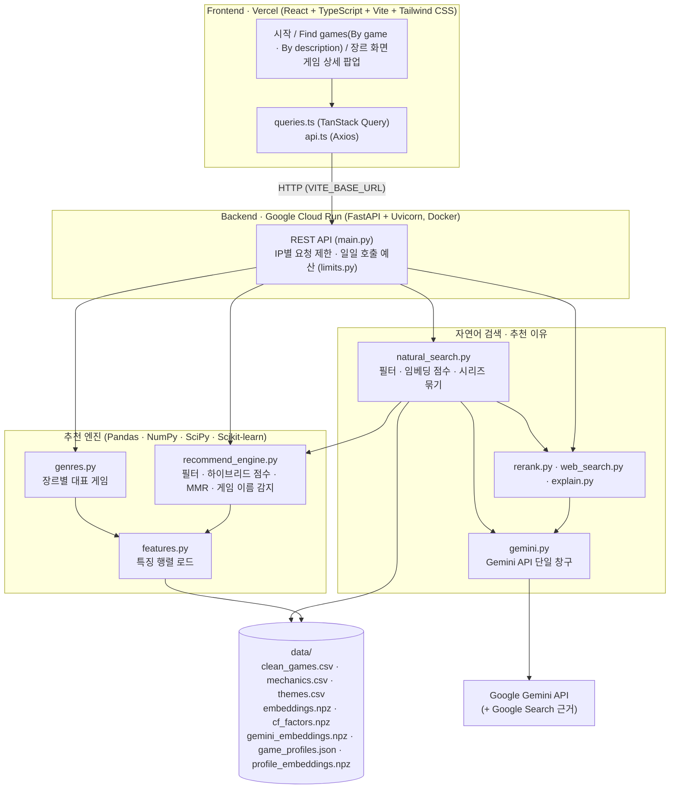

# 🏗️ 시스템 구조 (Architecture)

[🏠 메인 README로 이동](../README.md) • [📊 데이터셋](dataset.md) • [🔌 백엔드 API](backend_api.md)

## 1. 아키텍처



- 비슷한 게임 추천·장르·검색은 서버 안의 데이터만으로 동작하고 외부 호출이 없습니다.
- 자연어 검색과 추천 이유 문장만 Gemini API를 호출합니다. 키가 없으면 이 두 기능만 꺼집니다.

---

## 2. 기술 스택

| 분류 | 기술 / 도구 | 용도 |
| :--- | :--- | :--- |
| **Environment** | `uv`, `Python 3.12`, `Node.js` (v20.19+) | 가상환경·패키지 관리, 프론트엔드 빌드 |
| **Data & ML** | `Pandas`, `NumPy`, `SciPy`, `Scikit-learn` | 데이터 정제, 희소 행렬 코사인 유사도, TF-IDF, Truncated SVD(협업 필터링) |
| **LLM** | `google-genai` (`gemini-3.5-flash-lite`, `gemini-embedding-2`) | 자연어 검색 질의 이해·임베딩·재순위·웹 검색, 추천 이유, 게임 프로필 생성 |
| **Embedding (선택)** | `sentence-transformers` (`intfloat/multilingual-e5-small`) | 설명글 임베딩 생성, 이전 방식의 e5 시맨틱 검색 API |
| **Backend** | `FastAPI`, `Uvicorn` | REST API 서버, Swagger UI 문서화 |
| **Frontend** | `React 19`, `TypeScript`, `Vite 8`, `Tailwind CSS 4`, `TanStack Query 5`, `Axios`, `lucide-react` | 화면 구성, 서버 데이터 캐시, API 호출, 아이콘 |
| **Quality** | `unittest` + `httpx`(TestClient), `ruff`, `oxlint`, `tsc`, GitHub Actions | 테스트, Python·TS 린트·타입 검사, PR·main 자동 테스트 |
| **Deploy** | `Docker`, `Google Cloud Run`, `Vercel`, `GitHub Actions` | 백엔드·프론트엔드 배포 및 자동 배포 |
| **Collaboration** | `Git`, `GitHub`, `Jupyter Lab`, `VS Code` | 버전 관리, 데이터 탐색(EDA) |

---

## 3. 프로젝트 구조

```text
boardgame-recommender/
├── .github/workflows/
│   ├── test.yml                    # PR·main push 시 백엔드 테스트 자동 실행
│   └── deploy-backend.yml          # main push 시 Google Cloud Run 자동 배포
├── backend/                        # FastAPI 서버 & 추천 엔진
│   ├── main.py                     # REST API 엔드포인트, CORS, 요청 제한
│   ├── recommend_engine.py         # 조건 필터, 하이브리드 점수, 변형판 감점, MMR, 게임 이름 감지
│   ├── features.py                 # 데이터·특징 행렬 로드 (메커니즘, 테마, 카테고리, TF-IDF, 임베딩, CF)
│   ├── genres.py                   # 장르별 대표 게임 (GET /genres, GET /genres/{key}/games)
│   ├── natural_search.py           # 자연어 검색 파이프라인 (POST /search/natural)
│   ├── gemini.py                   # Gemini 호출 창구 (의도 추출, 임베딩, 이유, 프로필, 재순위, 웹 검색)
│   ├── rerank.py                   # Gemini 재순위 결과 검증
│   ├── web_search.py               # Google Search 근거 결과를 우리 게임과 맞추기
│   ├── explain.py                  # 추천 이유 한 문장 (POST /explain)
│   ├── profiles.py                 # 게임 프로필(game_profiles.json) 읽기
│   ├── series.py                   # 같은 시리즈(확장·버전·외전) 묶기 키
│   ├── limits.py                   # IP별 요청 제한, 일일 Gemini 호출 예산
│   ├── semantic.py                 # e5 임베딩 모델 로드·인코딩 (선택 기능)
│   ├── build_embeddings.py         # data/embeddings.npz 생성
│   ├── build_gemini_embeddings.py  # data/gemini_embeddings.npz 생성
│   ├── build_game_profiles.py      # data/game_profiles.json 생성
│   ├── build_profile_embeddings.py # data/profile_embeddings.npz 생성
│   ├── build_cf.py                 # data/cf_factors.npz 생성
│   ├── evaluate.py                 # 비슷한 게임 추천 오프라인 평가
│   └── evaluate_natural.py         # 자연어 검색 평가
├── frontend/                       # React 프론트엔드 (Vite + TypeScript) — frontend/README.md 참고
│   ├── .env.example                # VITE_BASE_URL 예시
│   ├── vite.config.js              # 개발 서버 포트, /api 프록시
│   └── src/
│       ├── App.tsx                 # 화면 전환 (시작 / Find games / 장르) + 헤더
│       ├── screens/                # StartScreen, RecommendScreen, GenreScreen
│       ├── components/             # SimilarSearch, DescriptionSearch, ResultList, GameDetailModal 등
│       ├── api.ts / queries.ts     # 백엔드 요청 함수 / TanStack Query 훅
│       └── types.ts                # 백엔드 응답 타입
├── data/                           # 데이터셋과 모델 산출물 (dataset.md 참고)
│   └── natural_eval_results/       # 자연어 검색 평가 결과
├── notebooks/                      # 1~3주차 데이터 탐색·실습
│   ├── read_game_csv.ipynb         # EDA, 정제
│   ├── clean_data.py               # 결측치·이상치 정제 → clean_games.csv
│   └── cosine_similarity.ipynb     # TF-IDF 코사인 유사도 실습
├── tests/                          # 자동 테스트 (API, 자연어 검색, Gemini 가짜 객체 등)
├── docs/                           # 프로젝트 문서
│   └── superpowers/                # 기능별 설계(specs)·구현 계획(plans) 기록
├── Dockerfile                      # 백엔드 배포 이미지 (Cloud Run)
└── pyproject.toml / uv.lock        # Python 의존성
```
