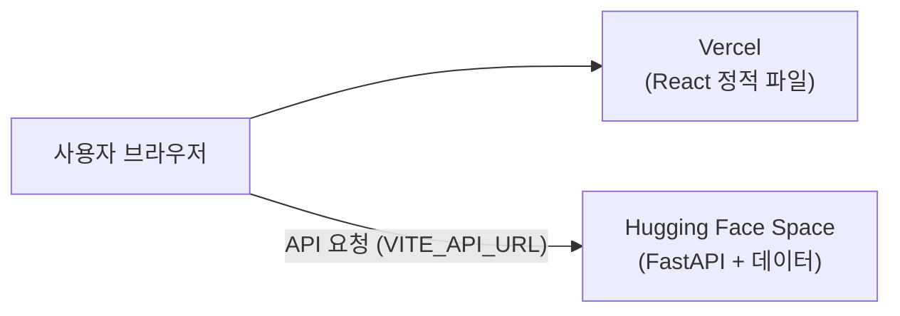

# 🚀 배포 가이드 (Deploy Guide)

[🏠 메인 README로 이동](../README.md) • [⚙️ 개발 환경 세팅 가이드](setup.md)

프론트엔드와 백엔드를 각각 무료 서비스에 올립니다.

| 구분 | 서비스 | 주소 예시 |
| :--- | :--- | :--- |
| 백엔드 (FastAPI) | Hugging Face Spaces (Docker) | `https://<아이디>-<스페이스이름>.hf.space` |
| 프론트엔드 (React + Vite) | Vercel | `https://<프로젝트이름>.vercel.app` |



> [!NOTE]
> 서버 메모리 사용량은 약 250MB입니다. 의미 기반 검색(`sentence-transformers`)은 설치하지 않으므로
> `/games/semantic-search` 만 꺼지고, 추천·검색·장르 화면은 모두 정상 동작합니다.

---

## 1. 백엔드 배포 (Hugging Face Spaces)

### 1.1 준비
1. [huggingface.co](https://huggingface.co/join) 에 가입합니다.
2. [Access Tokens](https://huggingface.co/settings/tokens) 에서 **Write** 권한 토큰을 만듭니다.
3. 터미널에서 로그인합니다 (토큰을 붙여넣기).
   ```bash
   uvx --from huggingface_hub hf auth login
   ```
4. `data/` 에 다음 파일이 있는지 확인합니다. 없으면 추천 품질이 떨어집니다.
   - `data/embeddings.npz` — `uv run --extra semantic python backend/build_embeddings.py`
   - `data/cf_factors.npz` — `uv run python backend/build_cf.py` (`data/user_ratings.csv` 필요)

### 1.2 업로드
프로젝트 루트에서 실행합니다. Space가 없으면 자동으로 만들어집니다.

```bash
uv run deploy/upload_space.py <아이디>/boardgame-recommender-api
```

- git에 올리지 않는 `.npz` 파일도 내 컴퓨터에서 바로 업로드됩니다.
- 업로드 후 Space 페이지에서 **Building → Running** 이 될 때까지 기다립니다 (첫 빌드 3~5분).
- `https://<아이디>-boardgame-recommender-api.hf.space/docs` 가 열리면 성공입니다.

코드를 고친 뒤 다시 배포할 때도 같은 명령을 실행합니다.

---

## 2. 프론트엔드 배포 (Vercel)

1. [vercel.com](https://vercel.com) 에 GitHub 계정으로 가입합니다.
2. **Add New → Project** 에서 `boardgame-recommender` 저장소를 가져옵니다.
3. 설정:
   | 항목 | 값 |
   | :--- | :--- |
   | Root Directory | `frontend` |
   | Framework Preset | Vite (자동 인식) |
   | Environment Variables | `VITE_API_URL` = 1.2에서 확인한 백엔드 주소 (끝에 `/` 없이) |
4. **Deploy** 를 누르면 `https://<프로젝트이름>.vercel.app` 주소가 생깁니다.

이후 `main` 브랜치에 push하면 자동으로 다시 배포됩니다.

> [!IMPORTANT]
> `VITE_API_URL` 은 빌드할 때 코드에 들어갑니다. 값을 바꾸면 Vercel에서 **Redeploy** 해야 반영됩니다.

---

## 3. CORS 연결 (백엔드에 프론트엔드 주소 등록)

백엔드는 허용된 주소에서 온 요청만 받습니다. Vercel 주소를 등록합니다.

```bash
uv run deploy/upload_space.py <아이디>/boardgame-recommender-api --origins https://<프로젝트이름>.vercel.app
```

또는 Space 페이지 **Settings → Variables and secrets** 에서 `ALLOWED_ORIGINS` 를 직접 추가해도 됩니다.
여러 주소는 쉼표로 구분합니다. 변수를 바꾸면 Space가 자동으로 재시작됩니다.

---

## 4. 자주 묻는 질문

**Q. 화면에 "서버에 연결할 수 없습니다" 같은 오류가 나요.**
- 브라우저 개발자 도구(F12) → Console 에 `CORS` 오류가 있으면 3번의 `ALLOWED_ORIGINS` 를 확인합니다 (`https://` 포함, 끝에 `/` 없이).
- Network 탭의 요청 주소가 `localhost:8000` 이면 Vercel의 `VITE_API_URL` 설정 후 Redeploy 합니다.

**Q. 한동안 안 쓰다가 접속하면 첫 요청이 느려요.**
- 무료 Space는 오래 사용하지 않으면 잠듭니다. 첫 요청 때 다시 켜지느라 1분 정도 걸릴 수 있습니다.

**Q. 로컬 개발에는 영향이 없나요?**
- 없습니다. 환경변수를 지정하지 않으면 기존처럼 `http://localhost:8000` 과 `http://localhost:5173` 을 사용합니다.
