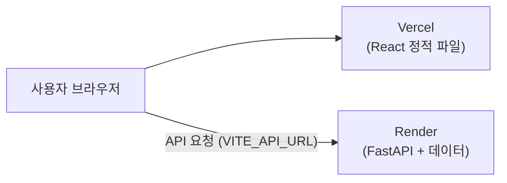

# 🚀 배포 가이드 (Deploy Guide)

[🏠 메인 README로 이동](../README.md) • [⚙️ 개발 환경 세팅 가이드](setup.md)

프론트엔드와 백엔드를 각각 무료 서비스에 올립니다. 두 서비스 모두 GitHub `main` 브랜치에 push하면 자동으로 다시 배포됩니다.

| 구분 | 서비스 | 주소 예시 |
| :--- | :--- | :--- |
| 백엔드 (FastAPI) | Render (Docker, Free) | `https://<서비스이름>.onrender.com` |
| 프론트엔드 (React + Vite) | Vercel (Hobby) | `https://<프로젝트이름>.vercel.app` |



> [!NOTE]
> - 서버 메모리 사용량은 약 250MB로 Render 무료 플랜(512MB) 안에 들어갑니다.
> - 의미 기반 검색(`sentence-transformers`)은 설치하지 않으므로 `/games/semantic-search` 만 꺼지고, 추천·검색·장르 화면은 모두 정상 동작합니다.
> - 추천에 쓰는 `data/embeddings.npz`, `data/cf_factors.npz` 는 git에 포함되어 있습니다. 다시 만들었다면 함께 커밋해야 배포에 반영됩니다.

> [!WARNING]
> Hugging Face Spaces의 Docker Space는 무료 플랜에서 만들 수 없어(PRO 구독 필요) Render를 사용합니다.

---

## 1. 백엔드 배포 (Render)

1. [render.com](https://render.com) 에서 **GitHub 계정으로 가입**합니다. 카드 등록은 필요 없습니다.
2. 대시보드에서 **New + → Web Service** 를 누릅니다.
3. **Git Provider → GitHub** 에서 `boardgame-recommender` 저장소를 고릅니다.
   목록에 없으면 **Configure account** 로 저장소 접근을 허용합니다.
4. 설정:
   | 항목 | 값 |
   | :--- | :--- |
   | Name | 예: `boardgame-recommender-api` (주소가 `https://boardgame-recommender-api.onrender.com` 이 됨) |
   | Language | **Docker** (저장소 루트의 `Dockerfile` 을 자동 인식) |
   | Branch | `main` |
   | Root Directory | 비워 둠 |
   | Instance Type | **Free** |
5. **Environment Variables** 에 CORS 허용 주소를 추가합니다.
   | Key | Value |
   | :--- | :--- |
   | `ALLOWED_ORIGINS` | Vercel 대표 주소 (예: `https://boardgame-recommender-nine.vercel.app`) |

   `https://` 포함, 끝에 `/` 없이 입력합니다. 여러 주소는 쉼표로 구분합니다.
6. **Deploy Web Service** 를 누릅니다. 첫 빌드는 5~10분 걸립니다.
7. 화면 왼쪽 위의 주소 뒤에 `/docs` 를 붙여 열었을 때 API 문서가 보이면 성공입니다.

---

## 2. 프론트엔드 배포 (Vercel)

1. [vercel.com](https://vercel.com) 에 GitHub 계정으로 가입합니다.
2. **Add New → Project** 에서 `boardgame-recommender` 저장소를 가져옵니다.
3. 설정:
   | 항목 | 값 |
   | :--- | :--- |
   | Root Directory | `frontend` |
   | Framework Preset | Vite (자동 인식) |
4. **Environment Variables** 에 백엔드 주소를 추가합니다.
   - Key: `VITE_API_URL`
   - Value: 1번에서 만든 Render 주소 (끝에 `/` 없이)
   - Type: **Config** (Secret 으로 저장하면 경고가 나오고, 나중에 Config 로 바꿀 수 없어 지우고 다시 만들어야 함)
5. **Deploy** 를 누르면 `https://<프로젝트이름>.vercel.app` 주소가 생깁니다.
   대표 주소는 **Settings → Domains** 에서 확인합니다.

> [!IMPORTANT]
> `VITE_API_URL` 은 빌드할 때 코드에 들어갑니다. 값을 바꾸면 **Deployments → ⋯ → Redeploy** 해야 반영됩니다.
> 이 값은 브라우저에 공개되는 주소일 뿐이라 공개되어도 괜찮습니다. 토큰 같은 비밀값은 `VITE_` 변수에 넣지 않습니다.

---

## 3. 서로 연결 확인

- Vercel 주소가 바뀌면 Render의 **Environment → `ALLOWED_ORIGINS`** 도 바꿉니다 (저장하면 자동 재배포).
- Render 주소가 바뀌면 Vercel의 `VITE_API_URL` 을 바꾸고 Redeploy 합니다.

PowerShell에서 CORS 설정을 확인하는 방법:

```powershell
curl.exe -s -i -H "Origin: https://<프로젝트이름>.vercel.app" https://<서비스이름>.onrender.com/genres | Select-String "access-control-allow-origin"
```

`access-control-allow-origin: https://<프로젝트이름>.vercel.app` 이 출력되면 정상입니다.

---

## 4. 자주 묻는 질문

**Q. 한동안 안 쓰다가 접속하면 첫 요청이 실패하거나 느려요.**
- Render 무료 플랜은 15분 동안 요청이 없으면 서버가 잠들고, 깨어나는 데 1분 정도 걸립니다.
- 프론트엔드의 요청 제한 시간(15초)보다 길어서 첫 요청이 실패할 수 있습니다. 잠시 후 새로고침하면 됩니다.

**Q. 화면에서 검색이 안 돼요.**
- F12 → Console 에 `blocked by CORS policy` 가 있으면 Render의 `ALLOWED_ORIGINS` 가 Vercel 주소와 정확히 같은지 확인합니다.
- F12 → Network 의 요청 주소가 `localhost:8000` 이면 Vercel의 `VITE_API_URL` 설정 후 Redeploy 합니다.

**Q. 로컬 개발에는 영향이 없나요?**
- 없습니다. 환경변수를 지정하지 않으면 기존처럼 `http://localhost:8000` 과 `http://localhost:5173` 을 사용합니다.
