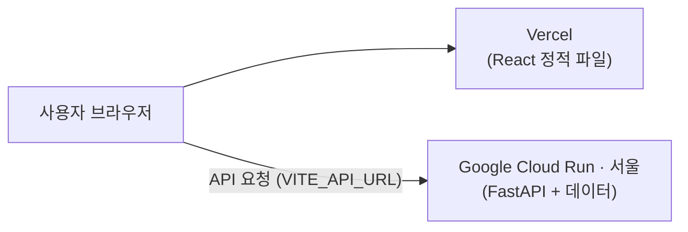

# 🚀 배포 가이드 (Deploy Guide)

[🏠 메인 README로 이동](../README.md) • [⚙️ 개발 환경 세팅 가이드](setup.md)

프론트엔드는 Vercel, 백엔드는 Google Cloud Run(서울 리전 `asia-northeast3`)에 배포합니다. `main` 브랜치에 push하면 두 서비스 모두 자동으로 다시 배포됩니다.

| 구분 | 서비스 | 주소 예시 |
| :--- | :--- | :--- |
| 백엔드 (FastAPI) | Google Cloud Run (`asia-northeast3`, Docker) | `https://boardgame-recommender-api-....run.app` |
| 프론트엔드 (React + Vite) | Vercel (Hobby) | `https://boardgame-recommender-nine.vercel.app` |



> [!NOTE]
> - 서버 메모리 사용량은 약 250MB(CSV 로드 피크 여유분 포함 `1Gi` 설정)이며, `embeddings.npz`가 있으면 TF-IDF 캐시를 건너뛰어 기동 시간을 단축합니다.
> - 의미 기반 검색(`sentence-transformers`)은 설치하지 않으므로 `/games/semantic-search` 만 꺼지고, 추천·검색·장르 화면은 모두 정상 동작합니다.
> - 추천에 쓰는 `data/embeddings.npz`, `data/cf_factors.npz` 는 git에 포함되어 있습니다. 다시 만들었다면 함께 커밋해야 배포에 반영됩니다.

---

## 1. 백엔드 배포 (Google Cloud Run · GitHub Actions OIDC)

[`.github/workflows/deploy-backend.yml`](../.github/workflows/deploy-backend.yml) 이 `main` 브랜치 push 시 Docker 이미지를 빌드해 Artifact Registry에 올리고 Cloud Run(`asia-northeast3`)에 배포합니다.

### 사전 GCP 설정 요약
1. **API 활성화**: Cloud Run Admin API, Artifact Registry API, Cloud Build API, IAM Service Account Credentials API
2. **Artifact Registry**: `asia-northeast3` 리전에 Docker 저장소(`boardgame-api`) 생성 + 최신 이미지 2~3개만 남기는 정리 정책 권장
3. **서비스 계정**: `boardgame-github-deployer` 에 아래 역할 부여
   - `Cloud Run 관리자` (`roles/run.admin`)
   - `Artifact Registry 작성자` (`roles/artifactregistry.writer`)
   - `서비스 계정 사용자` (`roles/iam.serviceAccountUser`)
4. **Workload Identity Federation (OIDC)**: 키 파일 대신 GitHub OIDC 토큰으로 인증
   - Pool(`github-pool`)과 OIDC Provider(`github-provider`, 발급자 `https://token.actions.githubusercontent.com`) 생성
   - 속성 매핑: `google.subject=assertion.sub`, `attribute.repository=assertion.repository`
   - 속성 조건: `assertion.repository == '<소유자>/<저장소>'`
   - 서비스 계정에 `repository` 속성 기준으로 액세스 권한 부여

### 배포 실행 및 주소 확인
1. `main` 브랜치에 push하거나 GitHub **Actions → Deploy Backend to Cloud Run → Run workflow** 를 실행합니다.
2. 마지막 **배포 URL 확인** 단계 로그(또는 GCP 콘솔 Cloud Run 서비스 상세)에서 `https://...run.app` 주소를 복사합니다.
3. 브라우저에서 `<Cloud Run URL>/docs` 가 열리면 백엔드 배포 성공입니다.

---

## 2. 프론트엔드 배포 (Vercel)

1. [vercel.com](https://vercel.com) 에 GitHub 계정으로 가입합니다.
2. **Add New → Project** 에서 `boardgame-recommender` 저장소를 가져옵니다.
3. 설정:

   | 항목 | 값 |
   | :--- | :--- |
   | Root Directory | `frontend` |
   | Framework Preset | Vite (자동 인식) |
4. **Environment Variables** 에 백엔드 주소를 추가합니다.
   - Key: `VITE_API_URL`
   - Value: 1번에서 확인한 Cloud Run 주소 (끝에 `/` 없이)
   - Type: **Config** (Secret 으로 저장하면 경고가 나오고, 나중에 Config 로 바꿀 수 없어 지우고 다시 만들어야 함)
5. **Deploy** 를 누르면 `https://<프로젝트이름>.vercel.app` 주소가 생깁니다.
   대표 주소는 **Settings → Domains** 에서 확인합니다.

> [!IMPORTANT]
> `VITE_API_URL` 은 빌드할 때 코드에 들어갑니다. 값을 바꾸면 **Deployments → ⋯ → Redeploy** 해야 반영됩니다.
> 이 값은 브라우저에 공개되는 주소일 뿐이라 공개되어도 괜찮습니다. 토큰 같은 비밀값은 `VITE_` 변수에 넣지 않습니다.

---

## 3. 서로 연결 확인

- Vercel 주소가 바뀌면 [`.github/workflows/deploy-backend.yml`](../.github/workflows/deploy-backend.yml) 의 `ALLOWED_ORIGINS` 를 수정해 재배포합니다.
- Cloud Run 주소가 바뀌면 Vercel의 `VITE_API_URL` 을 바꾸고 Redeploy 합니다.

PowerShell에서 CORS 설정을 확인하는 방법:

```powershell
curl.exe -s -i -H "Origin: https://boardgame-recommender-nine.vercel.app" https://<서비스주소>.run.app/genres | Select-String "access-control-allow-origin"
```

`access-control-allow-origin: https://boardgame-recommender-nine.vercel.app` 이 출력되면 정상입니다.

---

## 4. 자주 묻는 질문

**Q. 한동안 안 쓰다가 접속하면 첫 요청이 조금 느려요.**
- `min-instances=0` 설정에서는 일정 시간 요청이 없으면 컨테이너가 내려가고, 다음 요청 시 다시 시작됩니다.
- Startup CPU Boost(`--cpu-boost`), TF-IDF 지연 로딩, 시작 화면 진입 시 백엔드 워밍업(`warmupServer()`)을 적용해 두어 체감 지연을 최소화했습니다.

**Q. 화면에서 검색이 안 돼요.**
- F12 → Console 에 `blocked by CORS policy` 가 있으면 `ALLOWED_ORIGINS` 가 Vercel 주소와 정확히 같은지 확인합니다.
- F12 → Network 의 요청 주소가 `localhost:8000` 이면 Vercel의 `VITE_API_URL` 설정 후 Redeploy 합니다.

**Q. 로컬 개발에는 영향이 없나요?**
- 없습니다. 환경변수를 지정하지 않으면 기존처럼 `http://localhost:8000` 과 `http://localhost:5173` 을 사용합니다.
