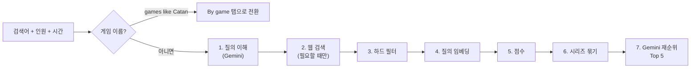

# 🔎 자연어 검색 가이드 (`POST /search/natural`)

[🏠 메인 README로 이동](../README.md) • [🧠 추천 파이프라인](recommendation_pipeline.md) • [🔌 백엔드 API](backend_api.md)

한국어·영어 검색어("친구들과 가볍게 하는 협력 게임")를 Gemini로 이해해 5개를 추천하는 "By description" 탭의 동작을 정리한 문서. 로컬 모델(`sentence-transformers`)이 필요 없어 Cloud Run에서도 동작함.
모든 명령은 프로젝트 최상위 폴더에서 실행하고, 루트 `.env`(git 제외)에 `GEMINI_API_KEY=...`가 있어야 함.

관련 코드: `backend/natural_search.py`(파이프라인), `backend/gemini.py`(Gemini 호출), `backend/rerank.py`(재순위), `backend/web_search.py`(웹 검색), `backend/profiles.py`·`backend/series.py`(프로필·시리즈), `backend/explain.py`(이유 문장)

## 1. 전체 흐름



### 0. 게임 이름 감지 (Gemini 호출 전)

`recommend_engine.detect_game`이 검색어에서 게임 이름을 찾음.

- **"games like Catan"**, "board games similar to Catan", "something similar to Catan"처럼 명시적인 유사 게임 패턴이고 이름이 데이터에 있으면 Gemini를 부르지 않고 `redirect_to_game: true`와 `suggested_game`을 돌려줌. 화면은 By game 탭으로 넘어가 같은 인원·시간으로 바로 추천함 (`exclude_ids`가 있는 Refresh 요청은 제외)
- 검색어 전체가 게임 이름과 정확히 같으면(예: "Catan") 검색은 그대로 진행하고 `suggested_game`만 채움. 화면은 "Looking for games similar to Catan? [Switch to By game]" 안내를 띄움
- 같은 이름의 판본이 여러 개면 리뷰 수가 가장 많은 것을 고름

### 1. 질의 이해

`gemini-3.5-flash-lite`가 검색어를 다음 조건으로 바꿈. 인원·시간은 화면 값만 사용함.

| 필드 | 의미 |
| --- | --- |
| `search_text` | 장르·핵심 메커니즘·플레이어 상호작용·분위기를 묘사하는 영어 2~3문장. 고유명사·게임 제목은 쓰지 않음 (예: "마피아 같은 게임" → 숨겨진 역할과 블러핑 묘사) |
| 포함·제외 메커니즘/테마 | 데이터의 이름 목록 안에서만 선택 |
| `weight_min`·`weight_max` | 난이도 범위 |
| `age_max` | 권장 나이 상한 |
| `categories` | BGG 카테고리 |
| `sort` | 순위 기준 (`relevance`·`popularity`·`rating`·`newest`, 아래 "순위 질의") |
| `low_text` | 설명이 짧은 게임을 찾는지 여부 |
| `keywords` | 메타데이터 키워드 (시리즈·제작자·국가) |
| `terms` | 단어 일치용 단어 (최대 3개) |
| `needs_web`, `web_query` | 바깥 사실이 필요한지, 필요하면 웹 검색어 |

검색어를 짧게 옮기면("game exploring space") 제목이나 설명글에 같은 단어가 들어간 게임이 올라와서 `search_text`를 묘사 문장으로 쓰게 함.

### 2. 웹 검색 (필요할 때만)

`needs_web`이면 필터링 **전에** Gemini가 Google Search 근거로 해당하는 게임 이름을 찾고, 이름을 우리 데이터의 게임과 맞춰 `web_ids`를 만듦. 자세한 규칙은 아래 "웹 검색" 절.

### 3. 하드 필터

- 인원, 최대 시간, 평점 5.5 이상, **리뷰 1,000개 이상**(장르 화면과 같은 기준)
- 제외 태그를 가진 게임, 난이도 범위 밖, 권장 나이가 `age_max`보다 높은 게임 제외 (난이도·나이를 모르는 게임은 남김)
- `exclude_ids`의 게임과, 그 게임과 **이름이 같은 다른 판본**도 제외 (`recommend_engine.exclude_mask`)
- 리뷰가 적은 무명 게임은 설명글이 짧고 일반적이라 짧은 질의와 가장 가깝게 나와 대표 게임을 밀어냄. 그래서 후보에서 뺌
- **메타데이터 키워드 하드 필터**: `keywords`가 게임 프로필 메타데이터(시리즈·제작자·국가)에 걸리는 후보가 하나라도 있으면 그 키워드를 필수 조건으로 씀. 웹 검색이 성공했으면 웹 근거가 필수 신호이고 프로필 제작자 정보는 틀릴 수 있어 이 필터는 쓰지 않고 태그로만 셈
- **웹 하드 필터**: 필터를 통과한 후보 중 웹이 확인한 게임이 5개 시리즈 이상(`WEB_HARD_MIN`)이면 그 게임들만 후보로 남김. 그보다 적으면 후보는 그대로 두고 웹 일치를 포함 태그 하나로 셈

### 4. 질의 임베딩

`gemini-embedding-2`(768차원)로 `search_text`를 벡터화해 `data/gemini_embeddings.npz`의 게임 벡터와 코사인 유사도를 계산함. 게임 프로필 임베딩이 있는 게임은 `0.5·원문 코사인 + 0.5·프로필 코사인`(`PROFILE_VECTOR_WEIGHT`)을 씀. `search_text`가 비면(순위 질의) 임베딩은 계산하지 않음.

### 5. 점수

- 유사도 = 0.7·임베딩 + 0.15·포함 태그 일치 비율 + 0.15·단어 일치(`terms`). 없는 신호는 빼고 나머지 비중으로 다시 맞춤
- 최종 점수 = 0.65·유사도 + 0.2·평점 + 0.15·보조 신호(추천 인원 적합도, 언어 의존도)

### 6. 시리즈 묶기

같은 시리즈(확장·버전·외전)는 대표 한 게임만 남김 (태그 일치가 많은 것, 같으면 리뷰 수가 많은 것). 웹이 확인한 게임이 5개 시리즈 미만이라 태그로만 쓰였다면 그 대표 게임들을 목록 맨 앞에 둬서 점수가 낮아도 재순위 후보 25개에 항상 들어가게 함.

### 7. Gemini 재순위

- 점수 상위 후보 25개(`SHORTLIST_SIZE`)를 `gemini-3.5-flash-lite`가 질문에 맞는 순서로 다시 정하고, 질문 해석 한 줄(`interpretation`, "Read as: ...")과 약한 일치 여부(`weak_match`)를 함께 돌려줌. 재순위 결과 뒤에 기존 순서를 이어 붙여 시리즈당 1개로 5개를 채움
- 재순위 호출이 5초(`RERANK_WALL_SECONDS`) 안에 끝나지 않거나 실패하면 건너뛰고, 이때만 기존 점수 순서에서 MMR(다양성 재정렬)로 5개를 고름
- 결과는 질의·인원·시간별로 캐시해 "Refresh"는 다시 호출하지 않음
- `weak_match`가 true면 화면이 "We couldn't find a close match. These are the nearest games."를 띄우고, `/explain`은 `weak_match`를 받아 이유 문장을 부드럽게 씀. 재순위 결과를 기존 순서로 채워야 했을 때도 true

## 2. 웹 검색

질문에 바깥 사실이 필요하면("Spiel des Jahres 수상작", "한국인이 만든 게임") 필터링 앞 단계에서 Gemini가 Google Search 근거로 게임 이름을 찾음. 응답의 `web`에 요약과 Google 검색어 추천 위젯 HTML이 담기고 화면은 "From the web" 상자로 보여 줌. 재순위에는 후보마다 "웹이 언급했는가"가 사실로 전달되고 프로필 메타데이터보다 웹을 우선함.

- 웹 검색이 성공했는데 결과 페이지에 웹이 확인한 게임이 3개 미만(`WEB_WEAK_MIN`)이면 `weak_match`를 true로 정함 (재순위 결과와 무관하게)
- 웹 결과가 쓰인 검색은 서버 캐시에 넣지 않으며(약관), 화면은 `/explain`에 `from_web: true`를 보내 이유도 캐시하지 않고 클라이언트 쿼리 캐시에도 남기지 않음
- 웹 질문에서 "Refresh"를 누르면 같은 질문으로 웹 검색을 다시 실행함(캐시를 쓰지 않으므로)
- 일일 한도(`WEB_SEARCH_DAILY_LIMIT`, 기본 100)를 넘거나 `NATURAL_WEB_SEARCH=0`이면 웹 없이 동작함
- 자동 평가(`evaluate_natural`)는 근거 결과를 저장·평가에 쓸 수 없어 항상 웹 검색을 끄고 실행함. 그래서 이 단계의 품질은 평가 점수에 안 잡히고 직접 확인해야 함
- 약관 요약과 배포 시 주의점은 [deploy.md](deploy.md) 참고

## 3. 순위 질의 ("가장 유명한 게임", "평점 높은 명작", "최신 게임")

"유명한", "평점 높은", "최신"은 장르가 아니라 순위 기준이고, 이 정보는 설명글이 아니라 리뷰 수·평점·출시 연도 열에 있음. 그래서 질의 이해 단계에서 Gemini가 `sort`도 함께 정함 (추가 호출 없음).

| `sort` | 예시 표현 | 정렬 열 |
| --- | --- | --- |
| `relevance` (기본) | 그 밖의 모든 질의 | 위 4~7번 그대로 |
| `popularity` | 유명한, 인기 있는, 국민 게임, 입문용 | `NumUserRatings` (리뷰 수) |
| `rating` | 평점 높은, 명작 (BGG 평점이지 게임 안의 점수가 아님) | `BayesAvgRating` |
| `newest` | 최신, 요즘 나온 | `YearPublished` (데이터는 2021년 출시작까지) |

- 장르 묘사가 없으면(`search_text`가 빈 문장) 임베딩 없이 조건에 맞는 게임 전체를 정렬함 → "가장 유명한 게임": Pandemic, Carcassonne, Catan…
- 포함 태그가 있으면 그 태그를 가진 게임 안에서만 정렬함 → "가장 유명한 협력 게임": Pandemic, Gloomhaven, Forbidden Island…
- 장르 묘사가 있으면 임베딩 상위 50개(`SORT_POOL`) 안에서 정렬함 → "명작으로 꼽히는 우주 게임": Terraforming Mars, Race for the Galaxy…
- 같은 값이면 리뷰 수가 많은 순. 다양성 재정렬은 하지 않음. 응답의 `SortedBy`로 어떤 기준이었는지 알 수 있고, 화면은 `newest`일 때 "데이터는 2021년 출시작까지" 안내를 띄움
- `Score`는 순위 목록 전체에 걸쳐 `1.0 - i/목록 길이`로 줄어듦 (1위 1.0)
- 설명 문장에는 리뷰 수·평점·출시 연도를 근거로 쓸 수 있음 (예: "over 100,000 BGG reviews")

## 4. 추천 이유 (`POST /explain`)

결과 5개의 이유를 Gemini 한 번 호출로 영어 한 문장씩 만듦 (메커니즘·테마·난이도·인원·시간·설명글 앞부분 등 주어진 게임 정보만 근거). "By game" 결과에도 같은 설명이 붙음. 실패하면 화면은 공통 메커니즘 칩을 보여 줌.

## 5. 데이터 준비

필요한 파일은 모두 git에 포함되어 있음. 게임 데이터를 바꿨을 때만 다시 만들어 커밋함 (배포 이미지에 포함됨).

```bash
# 설명글 Gemini 임베딩 → data/gemini_embeddings.npz (게임 21,125개, 약 7분, 약 $1.7, 이어서 실행 지원)
uv run --env-file .env python -m backend.build_gemini_embeddings

# 게임 프로필 → data/game_profiles.json
uv run --env-file .env python -m backend.build_game_profiles --sample   # 시범 약 50개 (결과를 직접 검토)
uv run --env-file .env python -m backend.build_game_profiles            # 전체 (중단 후 다시 실행하면 이어서 진행)

# 프로필 임베딩 → data/profile_embeddings.npz (약 1분, 약 400원)
uv run --env-file .env python -m backend.build_profile_embeddings
```

- 파일에 저장된 모델·차원이 코드와 다르면 자연어 검색이 꺼짐. 기존 `embeddings.npz`(e5)는 "비슷한 게임" 추천용으로 그대로 사용함
- 게임 프로필은 Gemini가 쓴 플레이 경험 설명 + franchise·base_game·제작자·국가 정보. 리뷰 1,000개 이상 게임(약 2,900개)이 대상이고, 제작자·국가는 리뷰 3,000개 이상 게임만 채움. 검색에만 쓰이고 화면에는 보이지 않음
- `natural_search.PROFILE_VECTOR_WEIGHT`(0~1)로 프로필 임베딩 반영 비율을 정함 (평가: `stage3_blend0/30/50.json`, `stage3_profilevec.json`). franchise·제작자·국가는 키워드 일치와 시리즈 묶기에 쓰임

## 6. 호출 제한과 설정

| 항목 | 값 |
| --- | --- |
| 검색어 길이 | 300자 이하 |
| `/search/natural` IP별 제한 | 60초에 10회 |
| `/explain` IP별 제한 | 60초에 30회 |
| `GEMINI_DAILY_CALL_LIMIT` | 인스턴스당 하루 Gemini 호출 수 (코드 기본 2000, 배포 300, UTC 자정 초기화) |
| `WEB_SEARCH_DAILY_LIMIT` | 인스턴스당 하루 웹 검색 수 (기본 100) |
| `NATURAL_WEB_SEARCH` | `0`이면 웹 검색 끔 (기본 켜짐) |

일일 카운터는 인스턴스 메모리에만 있어 재시작하면 0이 되는 느슨한 안전장치임. 실제 하드 한도는 Google 쪽 쿼터·예산 알림으로 설정함 ([deploy.md](deploy.md)). 같은 검색어·설명은 서버 메모리에 캐시함.

## 7. 검색 품질 평가

질의 40개(`data/natural_eval_queries.json`, 정답 `good` / 오답 `bad` 게임 id 포함)로 hit@5, precision@5, recall@25, 시리즈 중복, bad 비율을 측정함.

```bash
uv run --env-file .env python -m backend.evaluate_natural --label <이름>
```

- 결과는 `data/natural_eval_results/<이름>.json`에 저장되고 표가 출력됨
- 의도와 질의 벡터는 `data/natural_eval_cache.json`(git 제외)에 저장되어 재실행 시 Gemini 호출을 줄임
- 의도 추출 프롬프트를 바꿨다면 `--fresh-intents`로 저장된 의도를 무시하고 다시 추출함
- 비용: 캐시 없는 전체 실행 1회에 약 200~300원 (질의당 Gemini 호출 약 2회)

### 평가 결과

유형별 Hit@5 / Precision@5. baseline/stage2/stage3는 이전 단계, stage4 = Gemini 재순위 적용 (현재).

| 유형 (질의 수) | baseline | stage2 | stage3 | stage4 |
| --- | --- | --- | --- | --- |
| 전체 (40) | 0.82 / 0.35 | 0.88 / 0.36 | 0.88 / 0.42 | **0.97 / 0.53** |
| audience (7) | 0.71 / 0.23 | 0.71 / 0.23 | 0.71 / 0.23 | 1.00 / 0.60 |
| external (5) | 0.50 / 0.20 | 1.00 / 0.30 | 1.00 / 0.60 | 1.00 / 0.70 |
| genre (6) | 0.83 / 0.30 | 0.83 / 0.27 | 0.83 / 0.27 | 0.83 / 0.33 |
| mood (7) | 0.86 / 0.26 | 0.86 / 0.26 | 0.86 / 0.34 | 1.00 / 0.37 |
| ranking (4) | 1.00 / 0.85 | 1.00 / 0.90 | 1.00 / 0.90 | 1.00 / 0.90 |
| series (5) | 1.00 / 0.40 | 1.00 / 0.44 | 1.00 / 0.44 | 1.00 / 0.48 |
| no_answer (6) | - | - | - | 약한 일치 비율 0.83 |

- 4단계: 전체 Hit@5 0.88 → 0.97, Precision@5 0.42 → 0.53, Recall 0.59 → 0.64. 시리즈 중복률 0, 나쁜 게임 비율 0 유지
- 정답이 없는 질문(`no_answer`) 6개 중 5개(0.83)를 약한 일치로 표시함. 정답이 있는 질문의 약한 일치 비율은 external 0.20(1개) 외에는 0
- `SHORTLIST_SIZE` 25는 Hit@5 ≥ stage3, 중복 0 기준을 충족해 15·40은 시도하지 않음
- 지연: 재순위가 질의 이해·임베딩을 캐시한 뒤에도 요청당 약 1~1.5초를 더함 (설계 목표 약 2초 이내)
- 평가 결과 파일은 PR #23(게임 이름 감지·필터 강화) 이전에 만든 것임

설계 배경은 [superpowers/specs/2026-11-15-natural-search-accuracy-design.md](superpowers/specs/2026-11-15-natural-search-accuracy-design.md) 참고.
