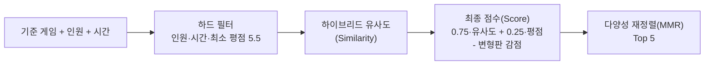

# 추천 파이프라인 가이드

`backend/recommend_engine.py`의 추천 방식과, 선택 기능(임베딩·협업 필터링·평가)을 준비하는 방법을 정리한 문서.
모든 명령은 프로젝트 최상위 폴더에서 실행함.

## 1. 전체 흐름



### 하이브리드 유사도의 신호

| 신호 | 데이터 | 계산 | 가중치 | 단계 |
| --- | --- | --- | --- | --- |
| `mechanics` | `data/mechanics.csv` | IDF 가중 코사인 (드문 메커니즘일수록 큰 의미) | 0.40 | 1단계 |
| `themes` | `data/themes.csv` | IDF 가중 코사인 | 0.15 | 1단계 |
| `category` | `games.csv`의 `Cat:*` + `GameWeight` | 카테고리 코사인과 난이도 차이의 평균 | 0.10 | 1단계 |
| `embedding` 또는 `tfidf` | 설명글 | 문장 임베딩 코사인. 임베딩 파일이 없으면 기존 TF-IDF 사용 | 0.20 | 2단계 |
| `cf` | `data/user_ratings.csv` | 협업 필터링 게임 벡터 코사인. 평점 수가 적으면 덜 신뢰 | 0.40 | 3단계 |

- 기준 게임에 데이터가 없는 신호는 제외함. 후보 게임에 데이터가 없으면 그 신호를 후보들의 중앙값으로 채움 (정보가 적은 게임이 점수를 부풀려 받지 않도록)
- 서버 시작 시 준비된 파일에 맞춰 신호가 자동 선택됨. `GET /`의 `signals`에서 확인 가능
- 가중치와 감점 강도는 `recommend_engine.py` 상단 상수(`SIGNAL_WEIGHTS`, `RATING_WEIGHT`, `VARIANT_PENALTY`, `DIVERSITY`)로 조정

### 기존 TF-IDF 방식에서 바뀐 점

- **플레이 방식 반영**: 설명글 단어 대신 메커니즘·테마로 비교하여 "플레이 감각이 비슷한" 게임을 찾음
- **변형판 감점**: 같은 `Family`이거나 이름에 기준 게임 이름이 포함된 게임은 감점 (예전에는 Catan 추천 5개가 모두 Catan 변형판이었음)
- **평점 반영**: 동점일 때만 쓰이던 평점을 점수의 25%로 반영
- **다양성**: 이미 고른 게임과 메커니즘이 거의 같은 게임은 감점하며 순서대로 고름
- **추천 이유**: 응답의 `SharedMechanics`, `SharedThemes`로 공통점을 보여줌

## 2. 2단계: 문장 임베딩 + 자연어 검색 (선택)

```bash
uv sync --extra semantic                                   # sentence-transformers, torch 설치 (용량 큼)
uv run --extra semantic python -m backend.build_embeddings # data/embeddings.npz 생성
uv run --extra semantic uvicorn backend.main:app --reload --port 8000
```

- 모델: `intfloat/multilingual-e5-small` (첫 실행 시 자동 다운로드, 약 470MB)
- 게임 이름 + 메커니즘 + 테마 + 설명글을 하나의 문서로 만들어 임베딩함
- 준비되면 추천의 텍스트 신호가 TF-IDF에서 임베딩으로 바뀌고, 자연어 검색이 활성화됨

```bash
curl 'http://localhost:8000/games/semantic-search?query=친구들과%20가볍게%20하는%20협력%20게임&players=4&max_time=60'
```

- `embeddings.npz`만 있고 `semantic` 패키지가 없으면 추천에는 임베딩을 쓰지만 자연어 검색은 `503`
- `embeddings.npz`는 배포에 필요해서 git에 포함되어 있음. 다시 만들었다면 함께 커밋함
- 배포 서버(Google Cloud Run)에는 `semantic` 패키지를 설치하지 않으므로 추천에는 임베딩을 쓰지만 자연어 검색은 꺼져 있음

### Gemini 자연어 검색 (`POST /search/natural`)

한국어·영어 검색어를 Gemini로 이해해 5개를 추천함. 로컬 모델(`sentence-transformers`)이 필요 없고 Cloud Run에서도 동작함.

1. **질의 이해**: `gemini-3.5-flash-lite`가 검색어를 `search_text`, 포함·제외 메커니즘/테마(데이터의 이름 목록 안에서만 선택), 난이도 범위(`weight_min`·`weight_max`), 권장 나이 상한(`age_max`), 카테고리(`categories`), 순위 기준(`sort`), 설명 짧은 게임 여부(`low_text`), 메타데이터 키워드(`keywords`: 시리즈·제작자·국가), 단어 일치용 단어(`terms`), 웹 검색 필요 여부(`needs_web`, `web_query`)로 바꿈. 인원·시간은 화면 값만 사용함
   - `search_text`는 검색어를 그대로 옮기지 않고, 장르·핵심 메커니즘·플레이어 상호작용·분위기를 묘사하는 영어 2~3문장으로 씀. 고유명사·게임 제목은 쓰지 않음 (예: "마피아 같은 게임" → 숨겨진 역할과 블러핑을 묘사)
   - 검색어를 짧게 옮기면("game exploring space") 제목이나 설명글에 같은 단어가 들어간 게임이 올라와서 이렇게 바꿈
2. **웹 검색 (필요할 때만)**: `needs_web`이면 필터링 **전에** Gemini가 Google Search 근거로 해당하는 게임 이름을 찾고(상세는 아래 "웹 검색"), 이름을 우리 데이터의 게임과 맞춰 `web_ids`를 만듦
3. **하드 필터**: 인원, 최대 시간, 평점 5.5 이상, **리뷰 1,000개 이상**(장르 화면과 같은 기준) + 제외 태그를 가진 게임·난이도 범위 밖·권장 나이가 `age_max`보다 높은 게임·`exclude_ids` 제외 (난이도·나이를 모르는 게임은 남김)
   - 리뷰가 적은 무명 게임은 설명글이 짧고 일반적이라 짧은 질의와 가장 가깝게 나와 대표 게임을 밀어냄. 그래서 자연어 검색 후보에서 뺌
   - **메타데이터 키워드 하드 필터**: `keywords`가 게임 프로필 메타데이터(시리즈·제작자·국가)에 걸리는 후보가 하나라도 있으면 그 키워드를 필수 조건으로 씀. 웹 검색이 성공했으면 웹 근거가 필수 신호이고 프로필 제작자 정보는 틀릴 수 있어 이 필터는 쓰지 않고 태그로만 셈
   - **웹 하드 필터**: 필터를 통과한 후보 중 웹이 확인한 게임이 5개 시리즈 이상(`WEB_HARD_MIN`)이면 그 게임들만 후보로 남김. 그보다 적으면 후보는 그대로 두고 웹 일치를 포함 태그 하나로 셈
4. **질의 임베딩**: `gemini-embedding-2`(768차원)로 `search_text`를 벡터화해 `data/gemini_embeddings.npz`의 게임 벡터와 코사인 유사도 계산. Gemini가 쓴 게임 프로필(`data/game_profiles.json`)의 임베딩이 있는 게임은 `0.5·원문 코사인 + 0.5·프로필 코사인`(`PROFILE_VECTOR_WEIGHT`)을 씀. `search_text`가 비면(순위 질의) 임베딩은 계산하지 않음
5. **점수**: 유사도 = 0.7·임베딩 + 0.15·포함 태그 일치 비율 + 0.15·단어 일치(`terms`), 없는 신호는 빼고 나머지 비중으로 다시 맞춤. 최종 점수 = 0.65·유사도 + 0.2·평점 + 0.15·보조 신호(추천 인원 적합도, 언어 의존도)
6. **시리즈 묶기**: 같은 시리즈(확장·버전·외전)는 대표 한 게임만 남김 (태그 일치가 많은 것, 같으면 리뷰 수가 많은 것). 웹이 확인한 게임이 5개 시리즈 미만이라 태그로만 쓰였다면 그 대표 게임들을 목록 맨 앞에 둬서 점수가 낮아도 재순위 후보 25개에 항상 들어가게 함
7. **Gemini 재순위**: 점수 상위 후보 25개(`SHORTLIST_SIZE`)를 `gemini-3.5-flash-lite`가 질문에 맞는 순서로 다시 정하고, 질문 해석 한 줄(`interpretation`)과 약한 일치 여부(`weak_match`)를 함께 돌려줌. 재순위 결과 뒤에 기존 순서를 이어 붙여 시리즈당 1개로 5개를 채움
   - 재순위 호출은 5초(`RERANK_WALL_SECONDS`) 안에 끝나지 않거나 어떤 이유로든 실패하면 건너뛰고, 이때만 기존 점수 순서에서 MMR(다양성 재정렬)로 5개를 고름. 결과는 질의·인원·시간별로 캐시해 "Refresh"는 다시 호출하지 않음
   - `weak_match`가 true면 화면이 "We couldn't find a close match. These are the nearest games."를 띄우고, `/explain`은 `weak_match`를 받아 이유 문장을 부드럽게 씀. 재순위 결과를 기존 순서로 채워야 했을 때도 true
   - 순위 질의의 `Score`는 순위 목록 전체에 걸쳐 `1.0 - i/목록 길이`로 줄어듦

**웹 검색** (2번 단계)

질문에 바깥 사실이 필요하면("Spiel des Jahres 수상작", "한국인이 만든 게임") 재순위가 아니라 필터링 앞 단계에서 Gemini가 Google Search 근거로 게임 이름을 찾음. 응답의 `web`에 요약과 Google 검색어 추천 위젯 HTML이 담기고 화면은 "From the web" 상자로 보여 줌. 재순위에는 후보마다 "웹이 언급했는가"가 사실로 전달되고 프로필 메타데이터보다 웹을 우선함

- 웹 검색이 성공했는데 결과 페이지에 웹이 확인한 게임이 3개 미만이면 `weak_match`를 true로 정함 (재순위 결과와 무관하게)
- 웹 결과가 쓰인 검색은 서버 캐시에 넣지 않으며(약관), 화면은 `/explain`에 `from_web: true`를 보내 이유도 캐시하지 않고 클라이언트 쿼리 캐시에도 남기지 않음
- 자동 평가(`evaluate_natural`)는 근거 결과를 저장·평가에 쓸 수 없어 항상 웹 검색을 끄고 실행함. 그래서 이 단계의 품질은 평가 점수에 안 잡히고 직접 확인해야 함
- 웹 질문에서 "Refresh"를 누르면 같은 질문으로 웹 검색을 다시 실행함(캐시를 쓰지 않으므로). 일일 한도(`WEB_SEARCH_DAILY_LIMIT`)를 넘거나 `NATURAL_WEB_SEARCH=0`이면 웹 없이 동작함

**순위 질의** ("가장 유명한 게임", "평점 높은 명작", "최신 게임")

"유명한", "평점 높은", "최신"은 장르가 아니라 순위 기준이고, 이 정보는 설명글이 아니라 리뷰 수·평점·출시 연도 열에 있음. 그래서 1단계에서 Gemini가 `sort`도 함께 정함 (추가 호출 없음).

| `sort` | 예시 표현 | 정렬 열 |
| --- | --- | --- |
| `relevance` (기본) | 그 밖의 모든 질의 | 위 4~7번 그대로 |
| `popularity` | 유명한, 인기 있는, 국민 게임, 입문용 | `NumUserRatings` (리뷰 수) |
| `rating` | 평점 높은, 명작 (BGG 평점이지 게임 안의 점수가 아님) | `BayesAvgRating` |
| `newest` | 최신, 요즘 나온 | `YearPublished` (데이터는 2021년 출시작까지) |

- 장르 묘사가 없으면(`search_text`가 빈 문장) 임베딩 없이 조건에 맞는 게임 전체를 정렬함 → "가장 유명한 게임": Pandemic, Carcassonne, Catan…
- 포함 태그가 있으면 그 태그를 가진 게임 안에서만 정렬함 → "가장 유명한 협력 게임": Pandemic, Gloomhaven, Forbidden Island…
- 장르 묘사가 있으면 임베딩 상위 50개 안에서 정렬함 → "명작으로 꼽히는 우주 게임": Terraforming Mars, Race for the Galaxy…
- 같은 값이면 리뷰 수가 많은 순. 다양성 재정렬은 하지 않음. 응답의 `SortedBy`로 어떤 기준이었는지 알 수 있고, 화면은 `newest`일 때 "데이터는 2021년 출시작까지" 안내를 띄움
- 설명 문장에는 리뷰 수·평점·출시 연도를 근거로 쓸 수 있음 (예: "over 100,000 BGG reviews")

`POST /explain`은 결과 5개의 이유를 Gemini 한 번 호출로 영어 한 문장씩 만듦 (주어진 게임 정보만 근거). "Find similar games" 결과에도 같은 설명이 붙음.

```bash
# 키는 저장소 루트 .env 에 GEMINI_API_KEY=... 로 두고 (git 제외됨) 실행
uv run --env-file .env python -m backend.build_gemini_embeddings   # data/gemini_embeddings.npz 생성
```

- 게임 21,125개, 약 7분, 비용 약 $1.7. 이어서 실행(중간 저장)을 지원함
- 게임 데이터가 바뀌면 다시 만들어 `gemini_embeddings.npz`를 함께 커밋해야 함 (배포 이미지에 포함됨)
- 파일에 저장된 모델·차원이 코드와 다르면 자연어 검색이 꺼짐. 기존 `embeddings.npz`(e5)는 "비슷한 게임" 추천용으로 그대로 사용함
- 호출 제한: `/search/natural` IP당 분당 10회, `/explain` 분당 30회, Gemini 호출 인스턴스당 하루 `GEMINI_DAILY_CALL_LIMIT`회(기본 2000)

## 3. 3단계: 협업 필터링 (선택)

학습된 `data/cf_factors.npz`가 git에 포함되어 있으므로 추천에는 별도 준비가 필요 없음. 아래는 다시 학습할 때의 절차.

1. Kaggle BGG 데이터셋에서 `user_ratings.csv`를 받아 `data/`에 넣음 (용량이 커서 git에 올리지 않음)
2. 학습

```bash
uv run python -m backend.build_cf   # data/cf_factors.npz 생성
```

- 사용자별 평균을 뺀 평점 행렬(게임 x 사용자)을 Truncated SVD로 64차원 게임 벡터로 압축함
- "이 게임을 좋아한 사람들이 함께 좋아한 게임"일수록 유사도가 높음
- 평가를 공정하게 하려고 사용자의 1/10은 학습에서 빼 둠 (`features.is_eval_user`)

## 4. 성능 평가

`user_ratings.csv`가 있어야 실행할 수 있음.

```bash
uv run python -m backend.evaluate --users 1000 --k 10
```

학습에서 뺀 사용자가 8점 이상 준 게임 하나를 기준 게임으로 주고, 그 사용자가 8점 이상 준 다른 게임이
Top 10에 얼마나 들어오는지 측정함. 평점순, 기존 TF-IDF, 1·2·3단계 결과를 한 표로 비교함.

| 지표 | 의미 |
| --- | --- |
| HitRate@K | 추천 K개 중 하나라도 맞힌 사용자 비율 |
| Recall@K | 맞힌 개수 / min(K, 정답 개수) |
| NDCG@K | 맞힌 게임이 위쪽에 있을수록 높은 점수 |
| Coverage | 추천된 서로 다른 게임 수 / 후보 게임 수 (낮으면 인기 게임만 반복) |

가중치를 바꾼 뒤 이 표로 비교하면 "더 좋아졌는지"를 숫자로 확인할 수 있음.

### 평가 결과 (평가 사용자 1000명, K=10, seed=0)

| 방식 | HitRate@10 | Recall@10 | NDCG@10 | Coverage |
| --- | --- | --- | --- | --- |
| 평점순 (기준선) | 0.432 | 0.098 | 0.106 | 0.0006 |
| TF-IDF (기존 방식) | 0.134 | 0.020 | 0.023 | 0.234 |
| 1단계 (+메커니즘/테마) | 0.452 | 0.083 | 0.084 | 0.103 |
| 2단계 (+임베딩) | 0.442 | 0.082 | 0.083 | 0.109 |
| **3단계 (+협업 필터링, 현재 기본값)** | **0.450** | **0.088** | **0.091** | 0.098 |
| CF 단독 | 0.326 | 0.056 | 0.064 | 0.156 |

- 기존 TF-IDF 대비 적중률 약 3.4배
- 평점순은 수치는 높지만 모든 사용자에게 같은 인기 게임 10개만 추천함 (Coverage 0.0006). 추천이라기보다 기준선
- 임베딩은 이 지표에서 TF-IDF와 차이가 오차 범위 수준. 대신 자연어 검색에 필요함
- 가중치(`CF 0.40`, `평점 0.25`)는 다른 사용자 표본(seed=1)으로 튜닝한 뒤 이 표본으로 확인함.
  평점 비중을 0.30 이상으로 올리면 적중률은 조금 더 오르지만 인기 게임 쏠림이 커져 0.25로 절충함

### 자연어 검색 평가 (질의 40개, `python -m backend.evaluate_natural --label <이름>`)

유형별 Hit@5 / Precision@5 (결과: `data/natural_eval_results/*.json`). baseline/stage2/stage3는 이전 단계의 평가 결과, stage4 = Gemini 재순위 적용.

| 유형 (질의 수) | baseline | stage2 | stage3 | stage4 |
| --- | --- | --- | --- | --- |
| 전체 (40) | 0.82 / 0.35 | 0.88 / 0.36 | 0.88 / 0.42 | **0.97 / 0.53** |
| audience (7) | 0.71 / 0.23 | 0.71 / 0.23 | 0.71 / 0.23 | 1.00 / 0.60 |
| external (5) | 0.50 / 0.20 | 1.00 / 0.30 | 1.00 / 0.60 | 1.00 / 0.70 |
| genre (6) | 0.83 / 0.30 | 0.83 / 0.27 | 0.83 / 0.27 | 0.83 / 0.33 |
| mood (7) | 0.86 / 0.26 | 0.86 / 0.26 | 0.86 / 0.34 | 1.00 / 0.37 |
| ranking (4) | 1.00 / 0.85 | 1.00 / 0.90 | 1.00 / 0.90 | 1.00 / 0.90 |
| series (5) | 1.00 / 0.40 | 1.00 / 0.44 | 1.00 / 0.44 | 1.00 / 0.48 |
| no_answer (6) | - | - | - | 약한 일치 비율 0.83 |

- 4단계: 전체 Hit@5 0.88 → 0.97, Precision@5 0.42 → 0.53, Recall 0.59 → 0.64. 시리즈 중복률 0, 나쁜 게임 비율 0 유지
- 정답이 없는 질문(`no_answer`) 6개 중 5개(0.83)를 약한 일치로 표시함. 정답이 있는 질문의 약한 일치 비율은 external 0.20(1개) 외에는 0
- `SHORTLIST_SIZE` 25는 Hit@5 ≥ stage3, 중복 0 기준을 충족해 15·40은 시도하지 않음
- 지연: 재순위가 질의 이해·임베딩을 캐시한 뒤에도 요청당 약 1~1.5초를 더함 (설계 목표 약 2초 이내)

## 5. 파일 구성

| 파일 | 역할 |
| --- | --- |
| `backend/features.py` | 데이터와 특징 행렬 로드 (메커니즘, 테마, 카테고리, TF-IDF, 임베딩, CF) |
| `backend/recommend_engine.py` | 하이브리드 점수, 변형판 감점, MMR, 자연어 검색 |
| `backend/semantic.py` | 임베딩 모델 로드와 문서·질의 인코딩 |
| `backend/build_embeddings.py` | `data/embeddings.npz` 생성 |
| `backend/gemini.py`, `backend/natural_search.py`, `backend/explain.py` | Gemini 호출, 자연어 검색 파이프라인, 설명 문장 |
| `backend/build_gemini_embeddings.py` | `data/gemini_embeddings.npz` 생성 |
| `backend/build_cf.py` | `data/cf_factors.npz` 생성 |
| `backend/evaluate.py` | 오프라인 성능 비교 |
