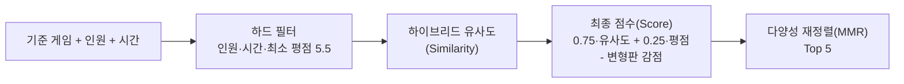

# 추천 파이프라인 가이드

`backend/recommend_engine.py`의 추천 방식과, 선택 기능(임베딩·협업 필터링·평가)을 준비하는 방법을 정리한 문서.
모든 명령은 프로젝트 최상위 폴더에서 실행함.

## 1. 전체 흐름



### 하이브리드 유사도의 신호

| 신호 | 데이터 | 계산 | 가중치 | 단계 |
| --- | --- | --- | --- | --- |
| `mechanics` | `data/mechanics.csv` | IDF 가중 코사인 (드문 메커니즘일수록 큰 의미) | 0.40 | 1단계 |
| `themes` | `data/themes.csv` | IDF 가중 코사인 | 0.15 | 1단계 |
| `category` | `games.csv`의 `Cat:*` + `GameWeight` | 카테고리 코사인과 난이도 차이의 평균 | 0.10 | 1단계 |
| `embedding` 또는 `tfidf` | 설명글 | 문장 임베딩 코사인. 임베딩 파일이 없으면 기존 TF-IDF 사용 | 0.20 | 2단계 |
| `cf` | `data/user_ratings.csv` | 협업 필터링 게임 벡터 코사인. 평점 수가 적으면 덜 신뢰 | 0.40 | 3단계 |

- 기준 게임에 데이터가 없는 신호는 제외함. 후보 게임에 데이터가 없으면 그 신호를 후보들의 중앙값으로 채움 (정보가 적은 게임이 점수를 부풀려 받지 않도록)
- 서버 시작 시 준비된 파일에 맞춰 신호가 자동 선택됨. `GET /`의 `signals`에서 확인 가능
- 가중치와 감점 강도는 `recommend_engine.py` 상단 상수(`SIGNAL_WEIGHTS`, `RATING_WEIGHT`, `VARIANT_PENALTY`, `DIVERSITY`)로 조정

### 기존 TF-IDF 방식에서 바뀐 점

- **플레이 방식 반영**: 설명글 단어 대신 메커니즘·테마로 비교하여 "플레이 감각이 비슷한" 게임을 찾음
- **변형판 감점**: 같은 `Family`이거나 이름에 기준 게임 이름이 포함된 게임은 감점 (예전에는 Catan 추천 5개가 모두 Catan 변형판이었음)
- **평점 반영**: 동점일 때만 쓰이던 평점을 점수의 25%로 반영
- **다양성**: 이미 고른 게임과 메커니즘이 거의 같은 게임은 감점하며 순서대로 고름
- **추천 이유**: 응답의 `SharedMechanics`, `SharedThemes`로 공통점을 보여줌

## 2. 2단계: 문장 임베딩 + 자연어 검색 (선택)

```bash
uv sync --extra semantic                                   # sentence-transformers, torch 설치 (용량 큼)
uv run --extra semantic python -m backend.build_embeddings # data/embeddings.npz 생성
uv run --extra semantic uvicorn backend.main:app --reload --port 8000
```

- 모델: `intfloat/multilingual-e5-small` (첫 실행 시 자동 다운로드, 약 470MB)
- 게임 이름 + 메커니즘 + 테마 + 설명글을 하나의 문서로 만들어 임베딩함
- 준비되면 추천의 텍스트 신호가 TF-IDF에서 임베딩으로 바뀌고, 자연어 검색이 활성화됨

```bash
curl 'http://localhost:8000/games/semantic-search?query=친구들과%20가볍게%20하는%20협력%20게임&players=4&max_time=60'
```

- `embeddings.npz`만 있고 `semantic` 패키지가 없으면 추천에는 임베딩을 쓰지만 자연어 검색은 `503`
- `embeddings.npz`는 배포에 필요해서 git에 포함되어 있음. 다시 만들었다면 함께 커밋함
- 배포 서버(Google Cloud Run)에는 `semantic` 패키지를 설치하지 않으므로 추천에는 임베딩을 쓰지만 자연어 검색은 꺼져 있음

### Gemini 자연어 검색 (`POST /search/natural`)

한국어·영어 검색어를 Gemini로 이해해 5개를 추천함. 로컬 모델(`sentence-transformers`)이 필요 없고 Cloud Run에서도 동작함.

1. **질의 이해**: `gemini-3.5-flash-lite`가 검색어를 `search_text`, 포함·제외 메커니즘/테마(데이터의 이름 목록 안에서만 선택), 난이도 범위로 바꿈. 인원·시간은 화면 값만 사용함
   - `search_text`는 검색어를 그대로 옮기지 않고, 장르·핵심 메커니즘·플레이어 상호작용·분위기를 묘사하는 영어 2~3문장으로 씀. 고유명사·게임 제목은 쓰지 않음 (예: "마피아 같은 게임" → 숨겨진 역할과 블러핑을 묘사)
   - 검색어를 짧게 옮기면("game exploring space") 제목이나 설명글에 같은 단어가 들어간 게임이 올라와서 이렇게 바꿈
2. **하드 필터**: 인원, 최대 시간, 평점 5.5 이상, **리뷰 1,000개 이상**(장르 화면과 같은 기준) + 제외 태그를 가진 게임·난이도 범위 밖·`exclude_ids` 제외
   - 리뷰가 적은 무명 게임은 설명글이 짧고 일반적이라 짧은 질의와 가장 가깝게 나와 대표 게임을 밀어냄. 그래서 자연어 검색 후보에서 뺌
3. **질의 임베딩**: `gemini-embedding-2`(768차원)로 `search_text`를 벡터화해 `data/gemini_embeddings.npz`의 게임 벡터와 코사인 유사도 계산
4. **점수**: 유사도 = 0.8·임베딩 + 0.2·포함 태그 일치 비율(태그 조건이 없으면 임베딩만), 최종 점수는 기존과 같이 0.75·유사도 + 0.25·평점
5. **다양성 재정렬**: MMR로 5개 선택

`POST /explain`은 결과 5개의 이유를 Gemini 한 번 호출로 영어 한 문장씩 만듦 (주어진 게임 정보만 근거). "Find similar games" 결과에도 같은 설명이 붙음.

```bash
# 키는 저장소 루트 .env 에 GEMINI_API_KEY=... 로 두고 (git 제외됨) 실행
uv run --env-file .env python -m backend.build_gemini_embeddings   # data/gemini_embeddings.npz 생성
```

- 게임 21,125개, 약 7분, 비용 약 $1.7. 이어서 실행(중간 저장)을 지원함
- 게임 데이터가 바뀌면 다시 만들어 `gemini_embeddings.npz`를 함께 커밋해야 함 (배포 이미지에 포함됨)
- 파일에 저장된 모델·차원이 코드와 다르면 자연어 검색이 꺼짐. 기존 `embeddings.npz`(e5)는 "비슷한 게임" 추천용으로 그대로 사용함
- 호출 제한: `/search/natural` IP당 분당 10회, `/explain` 분당 30회, Gemini 호출 인스턴스당 하루 `GEMINI_DAILY_CALL_LIMIT`회(기본 2000)

## 3. 3단계: 협업 필터링 (선택)

학습된 `data/cf_factors.npz`가 git에 포함되어 있으므로 추천에는 별도 준비가 필요 없음. 아래는 다시 학습할 때의 절차.

1. Kaggle BGG 데이터셋에서 `user_ratings.csv`를 받아 `data/`에 넣음 (용량이 커서 git에 올리지 않음)
2. 학습

```bash
uv run python -m backend.build_cf   # data/cf_factors.npz 생성
```

- 사용자별 평균을 뺀 평점 행렬(게임 x 사용자)을 Truncated SVD로 64차원 게임 벡터로 압축함
- "이 게임을 좋아한 사람들이 함께 좋아한 게임"일수록 유사도가 높음
- 평가를 공정하게 하려고 사용자의 1/10은 학습에서 빼 둠 (`features.is_eval_user`)

## 4. 성능 평가

`user_ratings.csv`가 있어야 실행할 수 있음.

```bash
uv run python -m backend.evaluate --users 1000 --k 10
```

학습에서 뺀 사용자가 8점 이상 준 게임 하나를 기준 게임으로 주고, 그 사용자가 8점 이상 준 다른 게임이
Top 10에 얼마나 들어오는지 측정함. 평점순, 기존 TF-IDF, 1·2·3단계 결과를 한 표로 비교함.

| 지표 | 의미 |
| --- | --- |
| HitRate@K | 추천 K개 중 하나라도 맞힌 사용자 비율 |
| Recall@K | 맞힌 개수 / min(K, 정답 개수) |
| NDCG@K | 맞힌 게임이 위쪽에 있을수록 높은 점수 |
| Coverage | 추천된 서로 다른 게임 수 / 후보 게임 수 (낮으면 인기 게임만 반복) |

가중치를 바꾼 뒤 이 표로 비교하면 "더 좋아졌는지"를 숫자로 확인할 수 있음.

### 평가 결과 (평가 사용자 1000명, K=10, seed=0)

| 방식 | HitRate@10 | Recall@10 | NDCG@10 | Coverage |
| --- | --- | --- | --- | --- |
| 평점순 (기준선) | 0.432 | 0.098 | 0.106 | 0.0006 |
| TF-IDF (기존 방식) | 0.134 | 0.020 | 0.023 | 0.234 |
| 1단계 (+메커니즘/테마) | 0.452 | 0.083 | 0.084 | 0.103 |
| 2단계 (+임베딩) | 0.442 | 0.082 | 0.083 | 0.109 |
| **3단계 (+협업 필터링, 현재 기본값)** | **0.450** | **0.088** | **0.091** | 0.098 |
| CF 단독 | 0.326 | 0.056 | 0.064 | 0.156 |

- 기존 TF-IDF 대비 적중률 약 3.4배
- 평점순은 수치는 높지만 모든 사용자에게 같은 인기 게임 10개만 추천함 (Coverage 0.0006). 추천이라기보다 기준선
- 임베딩은 이 지표에서 TF-IDF와 차이가 오차 범위 수준. 대신 자연어 검색에 필요함
- 가중치(`CF 0.40`, `평점 0.25`)는 다른 사용자 표본(seed=1)으로 튜닝한 뒤 이 표본으로 확인함.
  평점 비중을 0.30 이상으로 올리면 적중률은 조금 더 오르지만 인기 게임 쏠림이 커져 0.25로 절충함

## 5. 파일 구성

| 파일 | 역할 |
| --- | --- |
| `backend/features.py` | 데이터와 특징 행렬 로드 (메커니즘, 테마, 카테고리, TF-IDF, 임베딩, CF) |
| `backend/recommend_engine.py` | 하이브리드 점수, 변형판 감점, MMR, 자연어 검색 |
| `backend/semantic.py` | 임베딩 모델 로드와 문서·질의 인코딩 |
| `backend/build_embeddings.py` | `data/embeddings.npz` 생성 |
| `backend/gemini.py`, `backend/natural_search.py`, `backend/explain.py` | Gemini 호출, 자연어 검색 파이프라인, 설명 문장 |
| `backend/build_gemini_embeddings.py` | `data/gemini_embeddings.npz` 생성 |
| `backend/build_cf.py` | `data/cf_factors.npz` 생성 |
| `backend/evaluate.py` | 오프라인 성능 비교 |
